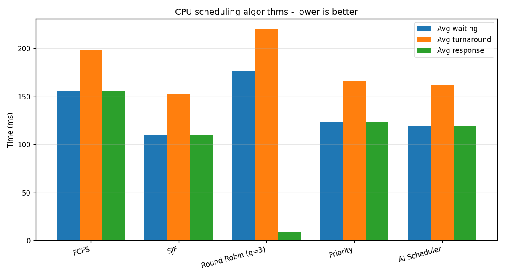
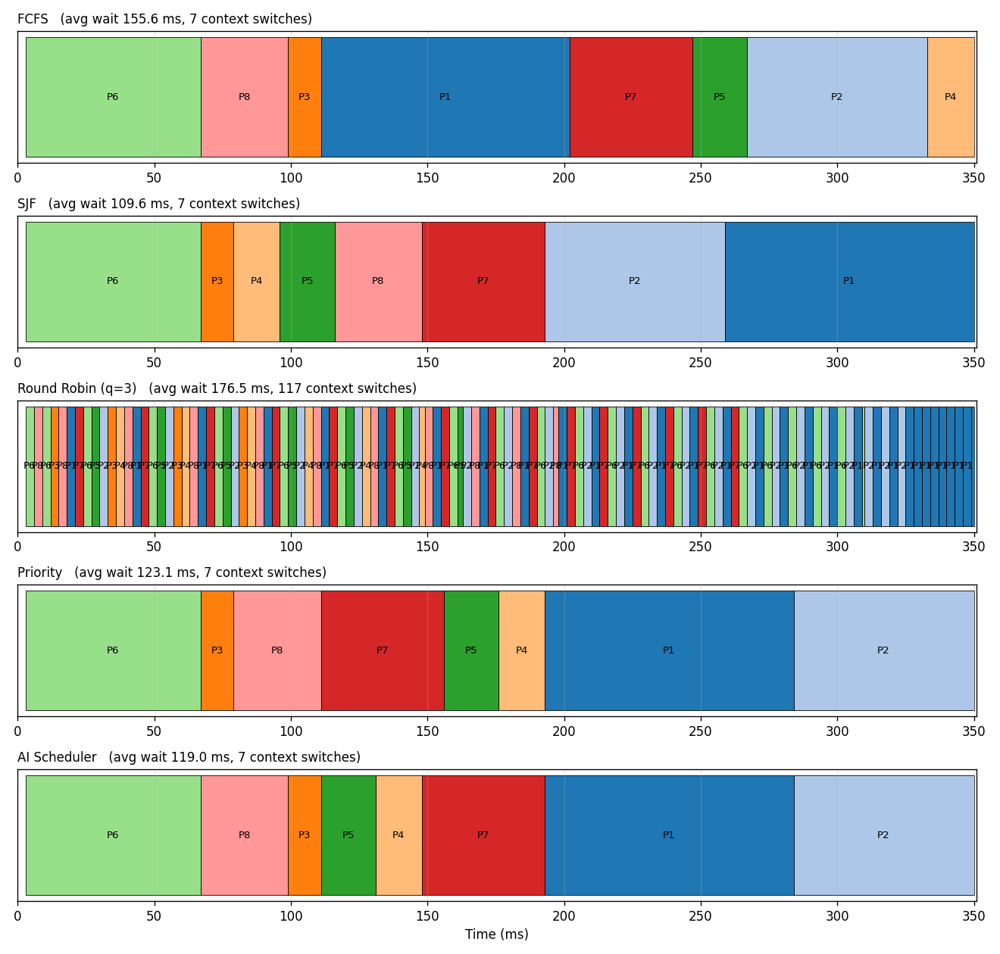

# AI Task Scheduler

An intelligent, machine-learning-driven CPU process scheduling simulator.
*BCSE303L – Operating Systems project.*

A scikit-learn model predicts each process's **CPU burst time** and **priority
class** before it runs, and the scheduler orders the ready queue using those
predictions. This approximates Shortest Job First (SJF) without needing burst
times to be known in advance. Five algorithms (FCFS, SJF, Round Robin, Priority,
and the AI scheduler) are simulated side by side on the same process set.

| | |
|---|---|
| Language | Python 3.10+ |
| Libraries | NumPy, Pandas, scikit-learn, Matplotlib, joblib, Flask |
| Team | Asher Mathew (24BDE0128), Krishiv Rajkumar (24BDE0132), Snigdha Muralidharan (24BDE0133) |

## Quick start

```bash
git clone https://github.com/LordFlyaway/OS_project.git
cd OS_project
pip install -r requirements.txt

python main.py train     # train + save the ML models
python main.py demo      # 8-process comparison, writes charts to outputs/
python dashboard/app.py  # interactive dashboard at http://127.0.0.1:5050
```

On Windows, double-click `run_all.bat` (setup, train, compare, run, tests, experiments, then the
dashboard opens). Full usage is in **[docs/USER_GUIDE.md](docs/USER_GUIDE.md)**.

## Noisy synthetic data

Real scheduling data is noisy, so the data generator (`src/data_generation.py`) has four noise
presets: `low`, `medium`, `high` (the default) and `extreme`. Each adds run-to-run variation in the
burst, a hidden load factor, a few outliers, measurement error on `past_cpu_usage`, and wrongly
recorded priority labels. `low` reproduces the original, nearly noise-free data. Switch the whole
project with the environment variable `SCHEDULER_NOISE`, for example `SCHEDULER_NOISE=medium`.
The noise levels are assumptions, not measurements of any real system.

## Results (default `high` noise, synthetic data)

200 random batches of 20 processes, average waiting time (lower is better):

| Algorithm | Avg waiting (ms) |
|---|---|
| FCFS | 425.95 |
| SJF (oracle: told every true burst) | 280.30 |
| Round Robin (q = 4) | 546.94 |
| Priority (oracle: told the true priority) | 327.29 |
| **AI scheduler** | **337.07** |

- The AI scheduler waits about **21% less than FCFS** and closes about **59%** of the FCFS-to-SJF gap.
- It beats FCFS and Round Robin in almost every batch, but the oracle Priority scheduler beats it in
  about two thirds of batches.
- Model quality on held-out data is modest because the data is very noisy: burst-time MAE about
  17.9 ms (R² 0.24), priority accuracy about 64%.
- On the original low-noise data the AI scheduler closed about 96% of the gap, so the benefit shrinks
  as noise grows (`experiments/results/e13_noise_sweep.png`).
- The learned priority class and the aging term do not measurably improve average waiting time
  (`experiments/run_extra_baselines.py`).
- The project reproduces a well-known idea (predict burst time with machine learning, then run SJF);
  it is not a new scheduling method.

8-process demo (`python main.py demo`, seed 7):

| Algorithm | Avg waiting (ms) | Avg turnaround (ms) | Avg response (ms) | Context switches |
|---|---|---|---|---|
| FCFS | 155.62 | 199.00 | 155.62 | 7 |
| SJF (oracle) | 109.62 | 153.00 | 109.62 | 7 |
| Round Robin (q=3) | 176.50 | 219.88 | 8.62 | 117 |
| Priority | 123.12 | 166.50 | 123.12 | 7 |
| **AI Scheduler** | **119.00** | **162.38** | **119.00** | **7** |




## Interactive dashboard

```bash
python dashboard/app.py        # then open http://127.0.0.1:5050
```

- **Simulator:** animated Gantt lanes for all five policies on the same batch (hover, zoom, pan, click a
  process to follow it across every policy), a decision inspector showing the AI scheduler's score for each
  waiting process, a scoreboard, and predicted-versus-true burst times.
- **Results:** the 200-batch experiments.
- **Graphs:** model comparison, scalability, how many trees, a multi-variable regression of what makes a
  forest reliable, and a weighted scorecard.

### Deploying it online

`render.yaml` is a [Render](https://render.com) blueprint. Create a free Render account, choose
**New > Blueprint**, and point it at this repository. The build trains the models; the start command
runs the Flask app with gunicorn. The free tier sleeps when idle, so the first load after a pause can
take about a minute.

## Experiments

All experiments are reproducible scripts in `experiments/`, with results in `experiments/results/`:
`run_experiments.py` (200 batches, aging, quantum, noise robustness), `run_noise_sweep.py` (data noise
levels), `run_extra_baselines.py` (ablations and naive baselines), `run_model_benchmark.py` and
`run_model_charts.py` (seven model families), `run_scalability.py`, `run_tree_reliability.py`,
`run_reliability_regression.py`, and `run_wide_data_test.py` (where does a Random Forest do best).
`pip install xgboost` is needed for the XGBoost rows.

## Repository layout

```
main.py                      command-line entry point
dashboard/                   Flask server + web page (animated Gantt, results, graphs)
experiments/                 reproducible experiments + result CSVs and figures
render.yaml                  one-click deploy blueprint (Render)
run_all.bat                  Windows: setup, run everything, open dashboard
src/
  process.py                 Process object (the simulator's PCB)
  data_generation.py         Module 1: synthetic historical process data + noise presets
  feature_engineering.py     Module 2: encoding + scaling
  prediction.py              Module 3: ML models + Predictor interface
  schedulers.py              Module 4: FCFS, SJF, RR, Priority, AI scheduler
  evaluation.py              Module 5: metrics table + charts
tests/test_schedulers.py     invariant tests
docs/USER_GUIDE.md           how to use it + how it works
```

## Tests

```bash
python -m unittest discover -s tests
```

## Note on the data

All data is synthetic, generated from a documented formula plus noise in `src/data_generation.py`. The
results show that the pipeline works and how it degrades with noise; they are not evidence of
performance on real process logs, which is listed as future scope.
